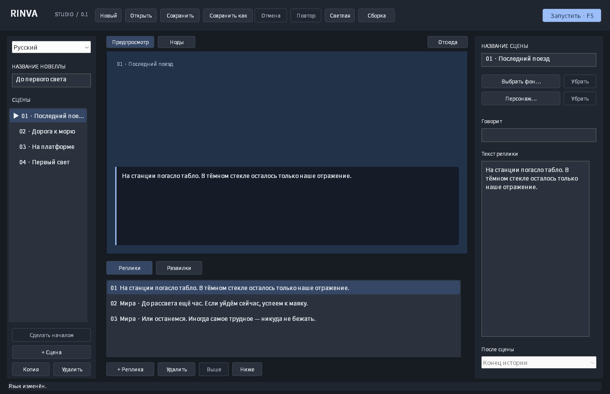

# Rinva Studio

Настольный редактор и движок визуальных новелл на **Rust**. Первая версия предназначена для **Windows 10/11 x64**. Интерфейс работает через Win32, без Electron, браузера и стороннего GUI-фреймворка. Переносимое ядро не зависит от Windows.

Статус: **рабочая альфа 0.1**. Это начало самостоятельного движка; возможности следующих версий перечислены в [плане развития](docs/ROADMAP.md).

## Скриншоты

Настоящие снимки Win32-приложения из автоматизированного запуска на Windows. В демонстрации фон ещё не импортирован; свои изображения можно добавить кнопкой «Выбрать фон».



[Светлая тема](docs/screenshots/editor-light.png) · [Редактирование развилок](docs/screenshots/choices.png) · [Проигрыватель](docs/screenshots/player.png)

## Создать первую новеллу

1. Запустите `rinva.exe`. Откроется небольшая демонстрационная история с двумя ветками.
2. Нажмите **Новый**, введите название и сохраните проект в отдельной папке.
3. Добавляйте сцены слева. Справа задайте название сцены, фон и изображение персонажа.
4. Во вкладке **Реплики** добавляйте текст и имя говорящего. Пустое имя означает повествователя. Реплики можно переставлять кнопками **Выше / Ниже**.
5. Во вкладке **Развилки** добавляйте ответы и выбирайте сцену назначения. Без ответов используется поле **После сцены**; «Конец истории» завершает новеллу.
6. Нажмите **F5** для прохождения от начала или **Отсюда** для проверки выбранной сцены.
7. Кнопка **Сборка** создаёт новую папку `имя.build` с `RinvaPlayer.exe`, сценарием и изображениями. Передавайте игрокам всю папку.

Изображения PNG/JPEG копируются в `assets/` внутри папки проекта. PNG с прозрачностью подходит для персонажа. Перемещайте проект вместе с этой папкой. «Сохранить как» переносит используемые изображения к новому проекту, не перезаписывая другие изображения с тем же именем.

## Что работает

- Пять языков интерфейса: English, Русский, 한국어, 日本語, 简体中文. Переключение сразу применяется и сохраняется между запусками; авторский текст не переводится.
- Нативные текстовые поля, Unicode, буфер обмена и клавиатурная навигация.
- Скругления 4 логических пикселя, полосы прокрутки с округлым бегунком, колесом, перетаскиванием и клавишами Home/End/Page Up/Page Down.
- Нодовый редактор сцен: связи, перетаскивание, масштаб, панорамирование, автокомпоновка и undo/redo.
- Сцены, реплики, произвольное количество ответов, автоматические переходы и выбор стартовой сцены.
- Фоны и один персонаж на сцену; предпросмотр 16:9.
- Общий проигрыватель в редакторе и экспортированной игре; возврат к предыдущей реплике/выбору.
- Сохранение и загрузка прогресса. Сохранение от изменённой версии истории отклоняется.
- Отмена/повтор действий; непрерывное редактирование поля объединяется в один шаг.
- Светлая и тёмная темы с сохранением выбора, DPI-масштабирование, изменение размера окна.
- Проверка отсутствующих переходов, пустых реплик, неоднозначных окончаний и бесконечных автоматических циклов.
- Сохранение через временный файл; предыдущая версия остаётся в `имя.rinva.bak`. Диалог защиты несохранённых изменений при закрытии/замене проекта.
- Фоновое автосохранение изменённого проекта каждые 15 секунд, включая проекты без имени. После сбоя редактор предложит восстановить правки.

Автокопии хранятся отдельно в `%LOCALAPPDATA%/Rinva/recovery`. У каждого окна свой сеанс; копии работающего редактора не предлагаются для восстановления в другом окне. Ручное сохранение и явный отказ от изменений удаляют автокопию этого сеанса. Если исходный файл изменился с момента начала работы, восстановление открывает несохранённую копию с сохранением путей к изображениям. Повреждённая последняя автокопия заменяется предыдущей целой резервной версией, если та доступна. Автокопия не заменяет ручное сохранение проекта.

## Сборка из исходников

Установите [Rust](https://rust-lang.org/tools/install/) и Visual Studio Build Tools с компонентом **Desktop development with C++**. Используйте актуальный стабильный Rust и зафиксированный `Cargo.lock`.

```powershell
cargo run --locked -p rinva-desktop
cargo build --locked --release -p rinva-desktop
# Шрифт для всех пяти языков; проверяется закреплённая версия Noto Sans CJK
powershell -File tools/fetch-fonts.ps1
```

Исполняемый файл: `target/release/rinva.exe`. Готовая Windows-сборка включает папку `fonts` со шрифтом Noto Sans CJK под SIL OFL. Он подключается только внутри приложения. Сохраняйте эту папку рядом с `.exe`; экспорт игры переносит её автоматически. При запуске из исходников без неё используются шрифты Windows, для которых могут понадобиться языковые компоненты CJK. Для `cargo run` загрузите шрифт командой `powershell -File tools/fetch-fonts.ps1 -Destination target/debug/fonts`.

```powershell
# Открыть проект в редакторе
rinva.exe examples/first-light.rinva

# Проиграть проект
rinva.exe --play examples/first-light.rinva

# Проверить проект (команда также доступна на Linux/macOS)
cargo run --locked -p rinva-desktop -- --validate examples/first-light.rinva
```

CI собирает Windows-приложение и сохраняет его в артефакте `rinva-windows-x64`. Артефакт `native-smoke` содержит результаты автоматизированного запуска и снимки интерфейса.

## Нодовый редактор

Откройте вкладку **Ноды** над предпросмотром. Каждый узел — существующая сцена; выходы — её варианты ответа или автоматический переход.

- Перетащите выход справа к входу или телу другой сцены, чтобы создать или изменить переход. Изменения сразу видны в инспекторе и проигрывателе.
- Выберите выход и нажмите **Разорвать** или Delete. Несоединённый ответ остаётся черновиком: перед запуском укажите ему сцену назначения либо удалите ответ.
- Перетаскивайте узлы за тело. Один жест — один шаг отмены; Esc и потеря захвата отменяют незавершённое перемещение.
- Колесо прокручивает холст, Shift+колесо — по горизонтали, Ctrl+колесо меняет масштаб вокруг курсора. Пустое место, средняя кнопка или Space+перетаскивание перемещают вид.
- **Расположить** автоматически расставляет узлы, **Вписать** показывает граф целиком. `+`/`−` меняют масштаб; F вписывает граф при фокусе на холсте.
- Стрелки двигают выбранный узел, Shift+стрелки — с шагом 10. Сцены можно выбирать в штатном списке слева, а связи менять через поля **После сцены** и **Перейти к сцене** справа.

Положения узлов сохраняются в `.rinva`, участвуют в отмене и автосохранении. Перестановка узлов не делает игровые сохранения несовместимыми. Старые проекты открываются без преобразования; после добавления позиций используйте актуальный редактор, поскольку старые сборки не знают нового необязательного поля.

## Управление

| Действие | Клавиши |
| --- | --- |
| Новый / открыть / сохранить | Ctrl+N / Ctrl+O / Ctrl+S |
| Сохранить как | Ctrl+Shift+S |
| Отменить / повторить действие редактора | Ctrl+Z / Ctrl+Y вне текстового поля; кнопки доступны всегда |
| Редактирование текста | Обычные нативные клавиши, включая Ctrl+Z внутри поля |
| Запустить с начала | F5 |
| Предпросмотр / ноды | Ctrl+G вне текстового поля |
| Перейти по элементам интерфейса | Tab / Shift+Tab |
| Выбрать ответ | Стрелки в списке, Enter или двойной щелчок |
| Сохранить / загрузить прогресс | F6 / F9 |
| Вернуться в редактор | Esc |

В игре полный текст также доступен в прокручиваемом текстовом поле под сценой. Это позволяет читать длинные реплики, которые не помещаются в превью.

## Архитектура и проверки

`rinva-core` содержит формат проекта, валидацию, проигрыватель, историю изменений и файловые операции. `rinva-desktop` переводит нативные события Windows в действия над этим ядром. Интерфейс не интерпретирует сценарий самостоятельно.

```powershell
cargo fmt --all -- --check
cargo test --locked --workspace
cargo clippy --locked --workspace --all-targets -- -D warnings
cargo build --locked --release -p rinva-desktop
target/release/rinva.exe --smoke-test smoke-output
```

Тесты ядра проверяют обе ветки демонстрации, возврат к выбору, несовместимые/повреждённые сохранения, undo/redo, Unicode, защиту путей, резервную копию, переносимость экспорта и восстановление черновиков при изменённом исходнике. Нативный smoke-тест создаёт настоящее Win32-окно, выполняет команды и ввод Unicode, проверяет автосохранение по таймеру, изоляцию живых сеансов, восстановление после завершения сеанса и отсутствие повторного появления копии после её удаления. Он не заменяет ручную проверку IME, экранного диктора, файловых диалогов и нескольких мониторов — см. [проверку интерфейса](docs/QA.md).

## Ограничения первой версии

- Только Windows-интерфейс; Linux/macOS поддерживают ядро и команду проверки.
- Пока нет музыки/озвучки, анимации, переменных/условий, локализационных таблиц авторского текста и веб/мобильного экспорта.
- Один персонаж на сцену, без позиционирования мышью. Фон заполняет кадр с обрезкой; персонаж вписывается целиком.
- До 4000 символов в реплике, 8 МБ в JSON-проекте, 32 МБ на изображение; декодер также ограничивает размеры и память.
- История редактора хранит до 100 снимков проекта, история проигрывания — до 1000 шагов. Это разумная стартовая модель для небольших историй; большие проекты потребуют журнала команд.
- Системные диалоги и всплывающие списки сохраняют оформление и язык системных кнопок Windows. Основные вертикальные полосы прокрутки оформлены приложением. Редактор не меняет системную тему.
- Автокопия сохраняет последние правки с интервалом до 15 секунд; при внезапном сбое самые последние изменения могут ещё не попасть в неё. Ctrl+S записывает проект сразу, `.bak` содержит предыдущую ручную запись.

Лицензия: [BSD-2-Clause](LICENSE).
