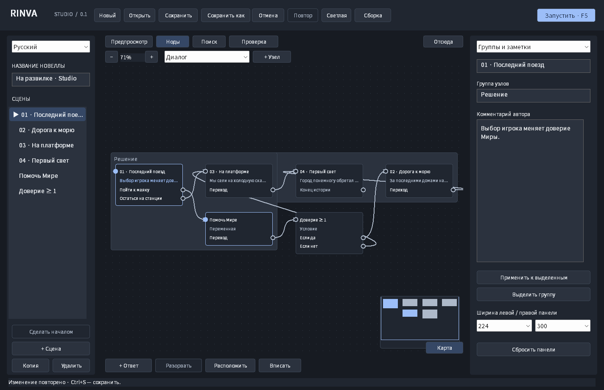
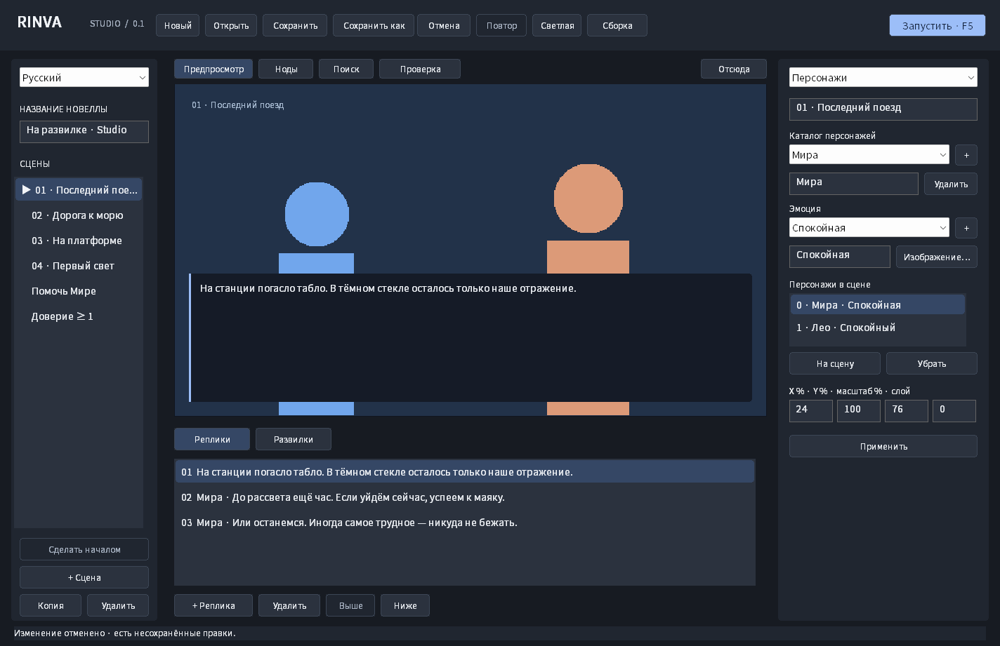
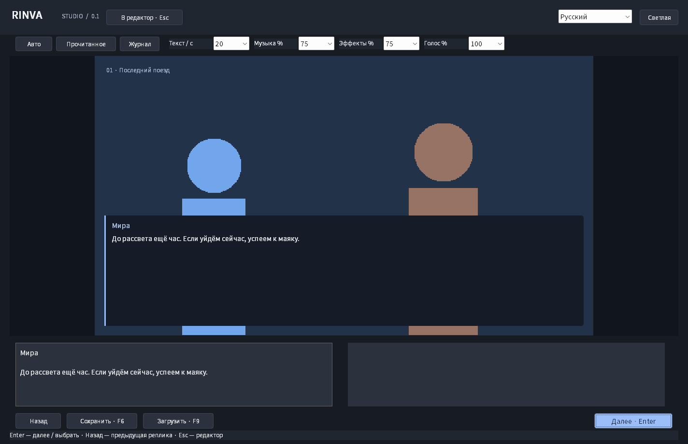
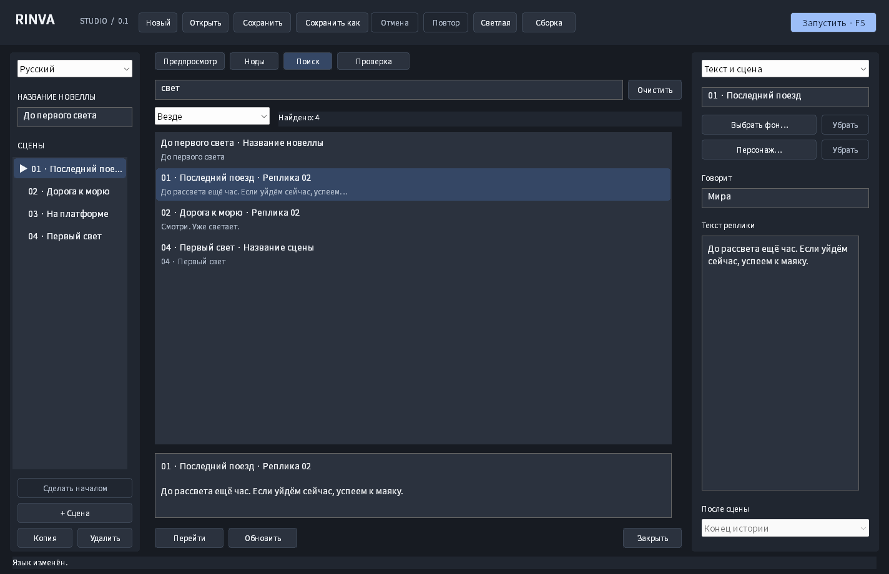
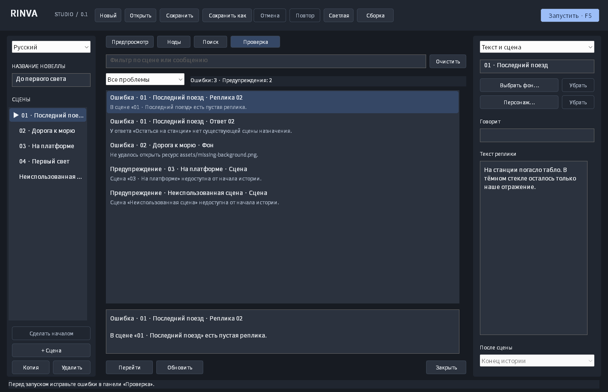

# Снимки интерфейса

Снимки клиентской области настоящего Win32-приложения, созданные командой `rinva.exe --smoke-test smoke-output` на Windows в GitHub Actions. Используется синхронная отрисовка работающих окон через `WM_PRINT`. Изображения не являются макетами и не дорисованы.

Версия исходников: [`cf9b145`](https://github.com/GBB-C2/rinva_engine/commit/cf9b145212c1166eaecb021ac7d8074d91ab9325). [Запуск проверок и исходные артефакты](https://github.com/GBB-C2/rinva_engine/actions/runs/42113858600).

## Studio: логика, звук, персонажи и чтение

Геометрические фигуры — прозрачные PNG для проверки размещения двух персонажей. Они созданы тестом и не выдаются за готовые иллюстрации. Аудиофайл — синтетический WAV; снимки показывают формы и состояние приложения, а не подтверждают слышимое воспроизведение.

## Поиск и проверка проекта

На экране проверки специально открыта копия демонстрации с пустой репликой, потерянным переходом, отсутствующим фоном и недоступной сценой. Нативный тест затем исправляет ошибки через инспектор и проверяет запуск истории с оставшимся предупреждением.

## Нодовый редактор

Язык интерфейса меняется независимо от языка истории: на всех снимках открыт один и тот же русский демонстрационный сценарий.

| Файл | Экран |
| --- | --- |
| [studio-nodes-ru.png](studio-nodes-ru.png) | Группа узлов, комментарий и миникарта |
| [studio-logic-ru.png](studio-logic-ru.png) | Переменные и условие с двумя выходами |
| [studio-characters-ru.png](studio-characters-ru.png) | Каталог персонажей, эмоция и координаты |
| [studio-audio-ru.png](studio-audio-ru.png) | Музыка, эффект, голос, громкость и переход |
| [studio-light.png](studio-light.png) | Звуковой инспектор в светлой теме |
| [studio-reader-ru.png](studio-reader-ru.png) | Чтение, громкость каналов и говорящий персонаж |
| [studio-backlog-ru.png](studio-backlog-ru.png) | Журнал пройденных реплик |
| [studio-small-ja.png](studio-small-ja.png) | Персонажи на японском при минимальном размере окна |
| [search-ru.png](search-ru.png) | Поиск на русском и просмотр найденной реплики |
| [search-light.png](search-light.png) | Поиск в светлой теме |
| [search-en.png](search-en.png) | Search — English |
| [search-ko.png](search-ko.png) | 검색 — 한국어 |
| [search-ja.png](search-ja.png) | 検索 — 日本語 |
| [search-zh.png](search-zh.png) | 搜索 — 简体中文 |
| [search-small-ja.png](search-small-ja.png) | Поиск при минимальном размере окна |
| [problems-ru.png](problems-ru.png) | Ошибки, предупреждения и точные поля назначения |
| [problems-light.png](problems-light.png) | Проверка в светлой теме |
| [problems-ja.png](problems-ja.png) | Проверка на японском |
| [nodes-ru.png](nodes-ru.png) | Русский, нодовый граф сцен |
| [nodes-en.png](nodes-en.png) | English |
| [nodes-ko.png](nodes-ko.png) | 한국어 |
| [nodes-ja.png](nodes-ja.png) | 日本語 |
| [nodes-zh.png](nodes-zh.png) | 简体中文 |
| [nodes-light.png](nodes-light.png) | Светлая тема и инспектор ответа |
| [editor-dark.png](editor-dark.png) | Редактор сцен и реплик, тёмная тема |
| [editor-light.png](editor-light.png) | Тот же проект в светлой теме |
| [choices.png](choices.png) | Варианты ответа и выбор сцены назначения |
| [player.png](player.png) | Проигрыватель в точке выбора |
| [scrollbars.png](scrollbars.png) | Прокрутка длинного текста и списка реплик |
| [editor-small-ja.png](editor-small-ja.png) | Японский интерфейс при минимальном размере окна |

На демонстрационных снимках фон ещё не импортирован. Системный всплывающий список может рисоваться отдельным окном Windows и не входить в снимок основной клиентской области; его открытие и отмена отдельно проверяются нативным smoke-тестом.
