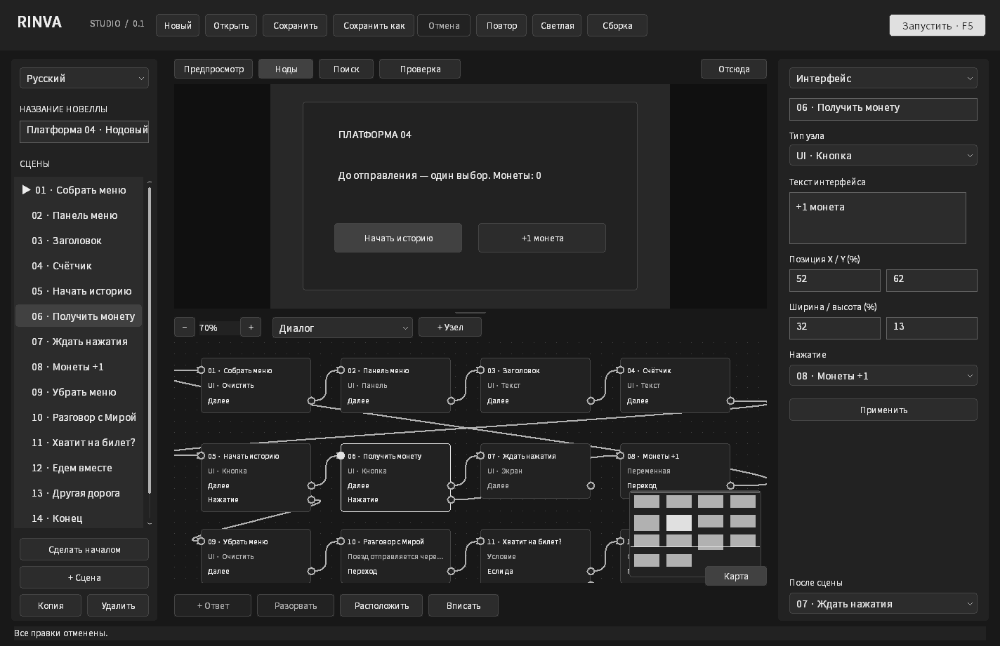
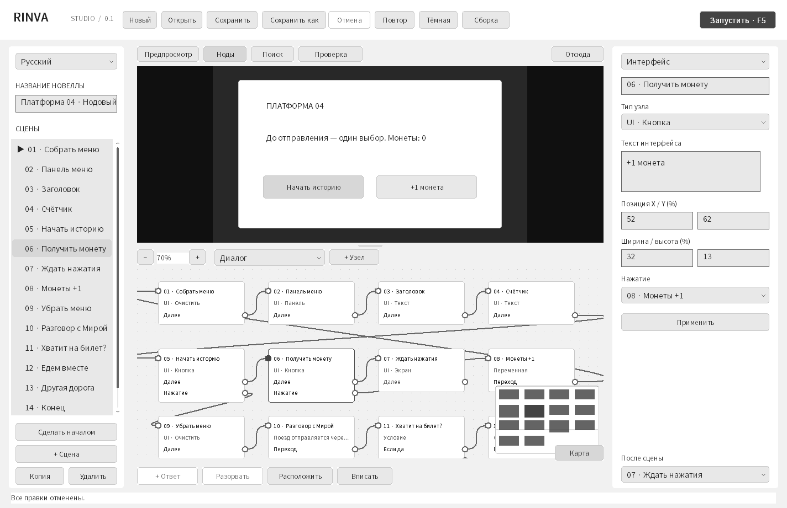
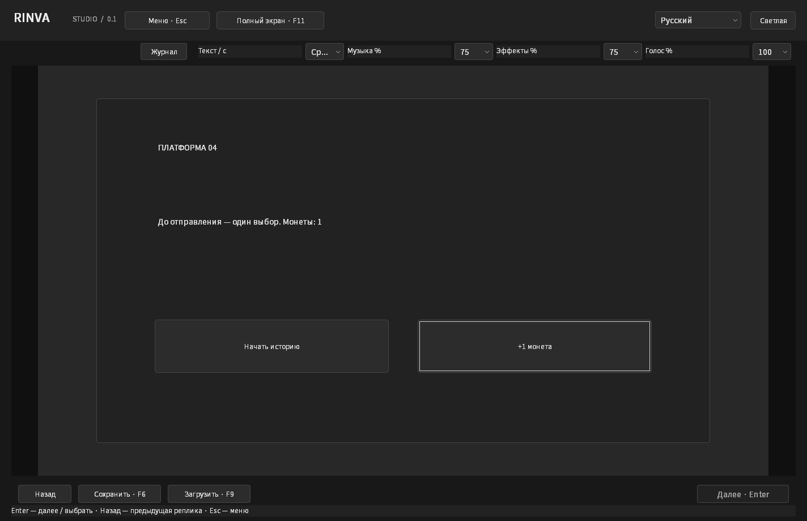
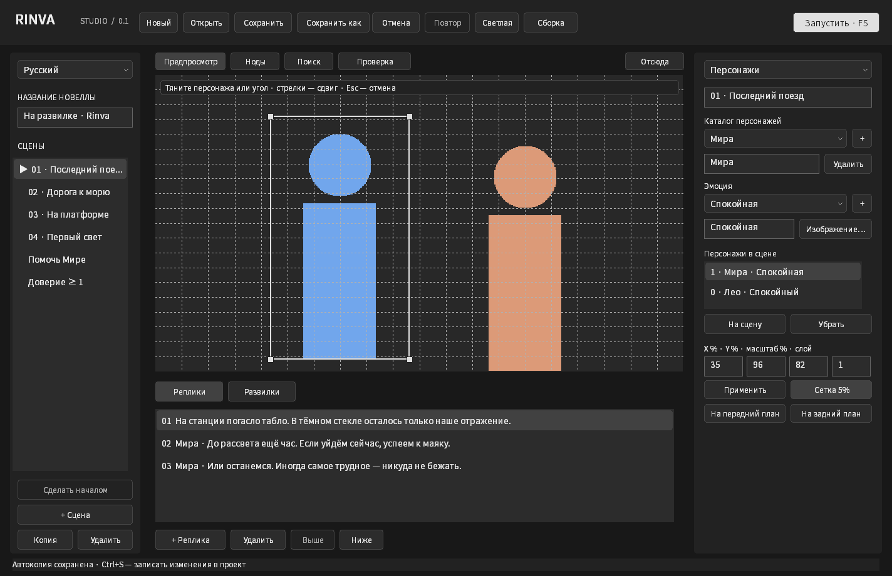
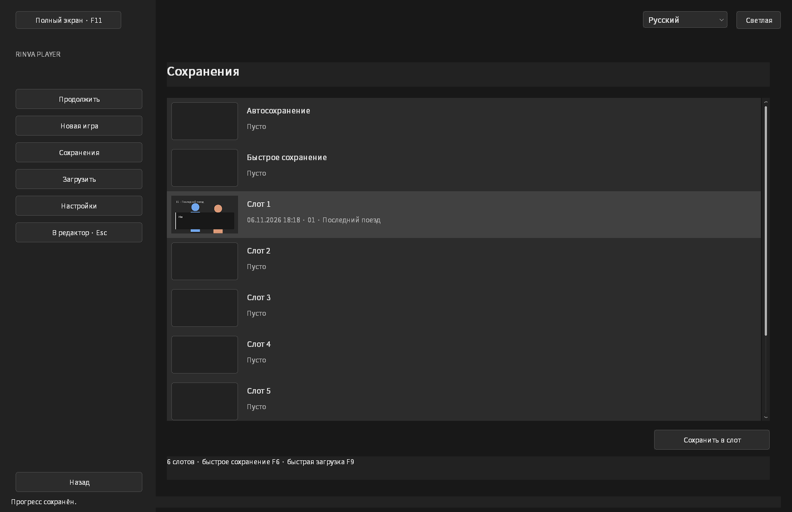
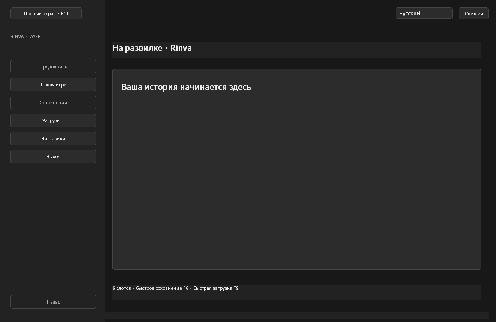

# Снимки интерфейса

Снимки клиентской области настоящего Win32-приложения, созданные командой `rinva.exe --smoke-test smoke-output` на Windows в GitHub Actions. Используется синхронная отрисовка работающих окон через `WM_PRINT`. Изображения не являются макетами и не дорисованы.

## Нейтральная палитра и нодовый интерфейс

Все снимки в этой папке обновлены из версии [`d152ee5`](https://github.com/GBB-C2/rinva_engine/commit/d152ee5c2c23d95b9f01581efb854c7d317d602a). [Проверки и оригинальные артефакты](https://github.com/GBB-C2/rinva_engine/actions/runs/42268146022). Редактор снят в release GNU/MinGW (`native-smoke-gnu`, каталог `smoke-output`); главное меню самостоятельной игры — в `smoke-player-output`.

| Файл | Экран |
| --- | --- |
| [node-workspace-dark.png](node-workspace-dark.png) | Предпросмотр меню, граф диалогов/механик/UI и параметры кнопки |
| [node-workspace-light.png](node-workspace-light.png) | Нейтральная светлая тема, те же связи и координаты |
| [node-interface-player.png](node-interface-player.png) | Кнопка увеличила переменную, меню пересобрано, счётчик обновлён |
| [node-workspace-small-ja.png](node-workspace-small-ja.png) | Японский интерфейс при минимальном размере окна 1120×760 |

Подписи нод при обычном масштабе показывают тип и выходы; при уменьшении ниже 40% остаются название и порты. Справа текст самой истории остаётся русским: язык редактора не меняет авторский сценарий. [Пример меню](../../examples/node-ui.rinva) и [инструкция](../NODES.md).

## Игровое меню и постановка сцены

| Файл | Экран |
| --- | --- |
| [stage-drag-ru.png](stage-drag-ru.png) | Постановка сцены, сетка 5% и порядок слоёв |
| [stage-light.png](stage-light.png) | Холст и инспектор в светлой теме |
| [player-menu-ru.png](player-menu-ru.png) | Пауза игры из редактора |
| [player-slots-ru.png](player-slots-ru.png) | Шесть ручных слотов, быстрый слот и автосохранение |
| [player-settings-ru.png](player-settings-ru.png) | Скорость текста, громкость, оформление и размер диалога |
| [player-settings-ja-light.png](player-settings-ja-light.png) | Настройки на японском в светлой теме |
| [player-dialogue-light.png](player-dialogue-light.png) | Светлое окно диалога и текст 150% |
| [standalone-title.png](standalone-title.png) | Первый экран экспортированной игры |

Геометрические персонажи — изображения для проверки движка. Инструкции по новым действиям находятся в [руководстве](../PLAYER_STAGE.md).

## Studio: логика, звук, персонажи и чтение

Геометрические фигуры — прозрачные PNG для проверки размещения двух персонажей. Они созданы тестом и не выдаются за готовые иллюстрации. Аудиофайл — синтетический WAV; снимки показывают формы и состояние приложения, а не подтверждают слышимое воспроизведение.

## Поиск и проверка проекта

На экране проверки специально открыта копия демонстрации с пустой репликой, потерянным переходом, отсутствующим фоном и недоступной сценой. Нативный тест затем исправляет ошибки через инспектор и проверяет запуск истории с оставшимся предупреждением.

## Нодовый редактор

Язык интерфейса меняется независимо от языка истории: на всех снимках открыт один и тот же русский демонстрационный сценарий.

| Файл | Экран |
| --- | --- |
| [studio-nodes-ru.png](studio-nodes-ru.png) | Группа узлов, комментарий и миникарта |
| [studio-logic-ru.png](studio-logic-ru.png) | Переменные и условие с двумя выходами |
| [studio-characters-ru.png](studio-characters-ru.png) | Каталог персонажей, эмоция и координаты |
| [studio-audio-ru.png](studio-audio-ru.png) | Музыка, эффект, голос, громкость и переход |
| [studio-light.png](studio-light.png) | Звуковой инспектор в светлой теме |
| [studio-reader-ru.png](studio-reader-ru.png) | Чтение, громкость каналов и говорящий персонаж |
| [studio-backlog-ru.png](studio-backlog-ru.png) | Журнал пройденных реплик |
| [studio-small-ja.png](studio-small-ja.png) | Персонажи на японском при минимальном размере окна |
| [search-ru.png](search-ru.png) | Поиск на русском и просмотр найденной реплики |
| [search-light.png](search-light.png) | Поиск в светлой теме |
| [search-en.png](search-en.png) | Search — English |
| [search-ko.png](search-ko.png) | 검색 — 한국어 |
| [search-ja.png](search-ja.png) | 検索 — 日本語 |
| [search-zh.png](search-zh.png) | 搜索 — 简体中文 |
| [search-small-ja.png](search-small-ja.png) | Поиск при минимальном размере окна |
| [problems-ru.png](problems-ru.png) | Ошибки, предупреждения и точные поля назначения |
| [problems-light.png](problems-light.png) | Проверка в светлой теме |
| [problems-ja.png](problems-ja.png) | Проверка на японском |
| [nodes-ru.png](nodes-ru.png) | Русский, нодовый граф сцен |
| [nodes-en.png](nodes-en.png) | English |
| [nodes-ko.png](nodes-ko.png) | 한국어 |
| [nodes-ja.png](nodes-ja.png) | 日本語 |
| [nodes-zh.png](nodes-zh.png) | 简体中文 |
| [nodes-light.png](nodes-light.png) | Светлая тема и инспектор ответа |
| [editor-dark.png](editor-dark.png) | Редактор сцен и реплик, тёмная тема |
| [editor-light.png](editor-light.png) | Тот же проект в светлой теме |
| [choices.png](choices.png) | Варианты ответа и выбор сцены назначения |
| [player.png](player.png) | Проигрыватель в точке выбора |
| [scrollbars.png](scrollbars.png) | Прокрутка длинного текста и списка реплик |
| [editor-small-ja.png](editor-small-ja.png) | Японский интерфейс при минимальном размере окна |

На демонстрационных снимках фон ещё не импортирован. Системный всплывающий список может рисоваться отдельным окном Windows и не входить в снимок основной клиентской области; его открытие и отмена отдельно проверяются нативным smoke-тестом.
