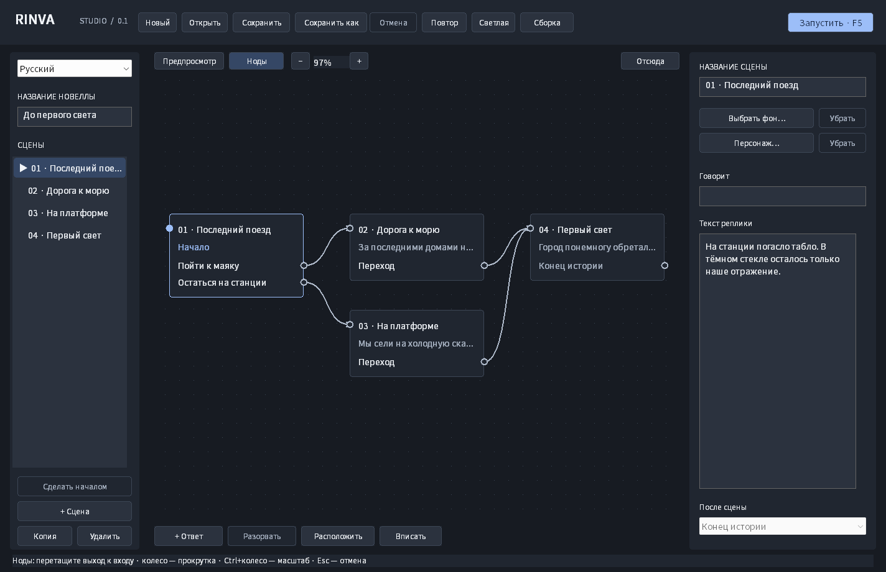
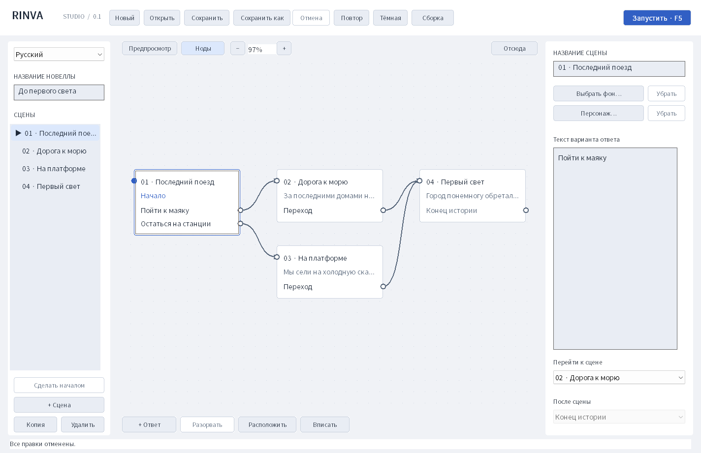

# Снимки интерфейса

Снимки клиентской области настоящего Win32-приложения, созданные командой `rinva.exe --smoke-test smoke-output` на Windows в GitHub Actions. Используется синхронная отрисовка работающих окон через `WM_PRINT`. Изображения не являются макетами и не дорисованы.

Версия исходников: [`1ecdc0e`](https://github.com/GBB-C2/rinva_engine/commit/1ecdc0ed99b3d6ee3effe578f60067959ec47f4c). [Запуск проверок и исходные артефакты](https://github.com/GBB-C2/rinva_engine/actions/runs/42090060254).

## Нодовый редактор

Язык интерфейса меняется независимо от языка истории: на всех снимках открыт один и тот же русский демонстрационный сценарий.

| Файл | Экран |
| --- | --- |
| [nodes-ru.png](nodes-ru.png) | Русский, нодовый граф сцен |
| [nodes-en.png](nodes-en.png) | English |
| [nodes-ko.png](nodes-ko.png) | 한국어 |
| [nodes-ja.png](nodes-ja.png) | 日本語 |
| [nodes-zh.png](nodes-zh.png) | 简体中文 |
| [nodes-light.png](nodes-light.png) | Светлая тема и инспектор ответа |
| [editor-dark.png](editor-dark.png) | Редактор сцен и реплик, тёмная тема |
| [editor-light.png](editor-light.png) | Тот же проект в светлой теме |
| [choices.png](choices.png) | Варианты ответа и выбор сцены назначения |
| [player.png](player.png) | Проигрыватель в точке выбора |
| [scrollbars.png](scrollbars.png) | Прокрутка длинного текста и списка реплик |
| [editor-small-ja.png](editor-small-ja.png) | Японский интерфейс при минимальном размере окна |

На демонстрационных снимках фон ещё не импортирован. Системный всплывающий список может рисоваться отдельным окном Windows и не входить в снимок основной клиентской области; его открытие и отмена отдельно проверяются нативным smoke-тестом.
